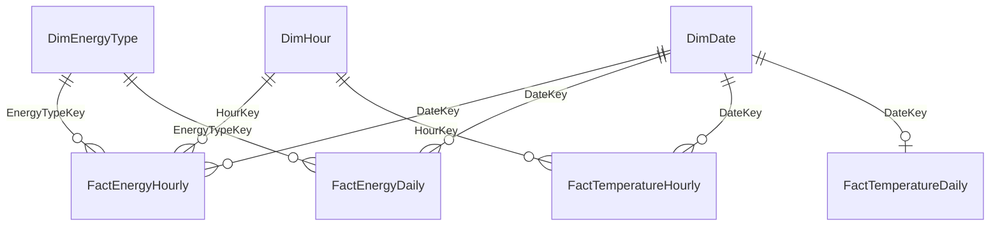

# Household Energy Dashboard

A Power BI dashboard, star-schema data model and data-quality review of a UK family's hourly gas and electricity use, built as a **Junior Data Analyst technical assessment**.

The client (the household's bill payer) wanted to understand trends, spot anomalies and find ways to cut energy costs. This project turns two raw CSV extracts into a clean, documented star schema — built twice, in **SQL Server** and in **R**, with matching outputs — and a Power BI dashboard on top of it.

---

## The brief

| Dataset | Grain | Period |
|---|---|---|
| `Energy Use Full.csv` | Date × Hour × Energy Type (Gas / Electric) | 20 Nov 2022 – 30 Jun 2024 |
| `Temperature.csv` | Date × Hour (outdoor °C, same location) | 20 Nov 2023 – 30 Jun 2024 |

A family of four in a three-bedroom UK house. Gas covers central heating, cooking and hot water; electricity provides no heating. The temperature sensor is sometimes in direct sunlight, so it can overstate the temperature on clear days.

**Requirements**

- Build a star-schema data model for Power BI
- Write example SQL (against SQL Server) that produces the tables for the semantic model
- Identify data-quality issues and recommend how to cleanse them
- Build an interactive dashboard that surfaces patterns, anomalies and savings opportunities
- Show **daily energy use as a % of the monthly total**, only for months with complete data

---

## Repository structure

```
.
├── PowerBI/
│   └── Household Energy Dashboard.pbix   # the dashboard and semantic model
├── scripts/
│   └── energy_model.R                    # R build of the star schema (also usable as a Power BI R source)
├── sql/
│   └── 02_build_star_schema.sql          # SQL Server build of the same star schema
└── README.md
```

> The raw CSVs are not included in this repository. To rebuild the model, put `Energy Use Full.csv` and `Temperature.csv` in the repository root.

---

## Data model

A star schema with three dimensions, four fact tables and a data-quality log. The SQL and R builds produce the same eight tables.



| Table | Grain | Highlights |
|---|---|---|
| **DimDate** | One row per day | Calendar fields, UK bank holidays, weekend/weekday day type, season, clock-change days, year-on-year `ComparisonPeriod`, temperature band |
| **DimHour** | One row per hour (0–23) | Hour label, time-of-day band |
| **DimEnergyType** | Electricity, Gas | Source unit and an editable kWh conversion factor |
| **FactEnergyHourly** | Date × Hour × Fuel | Full grid, so gaps are explicit; `IsMissing`, `MissingReason`, `IsHighLoadHour` |
| **FactEnergyDaily** | Date × Fuel | Daily totals, readings count, `IsCompleteMonth`, **`DailyPctOfMonth`** |
| **FactTemperatureHourly** | Date × Hour | Raw and cleansed temperature, missing / sun-affected / repaired flags |
| **FactTemperatureDaily** | Date | Mean, min, max and heating degree days (base 15.5 °C) |
| **DataQualityLog** | One row per issue | Plain-English issue, records affected, evidence and treatment |

### Design rules

- **Never invent usage.** The energy facts sit on a complete Date × Hour × Fuel grid. A missing reading becomes a flagged `NULL` row, never an estimate.
- **"Complete month" is defined per fuel:** every calendar day has at least one reading. Only complete months get a `DailyPctOfMonth` value, which answers the client's headline requirement.
- **Keep the raw temperature.** Readings that look sun-inflated are flagged and treated as missing. Gaps of up to 6 hours are linearly interpolated; longer gaps stay `NULL`.
- **One place for business rules.** Thresholds (high-load kWh, sun-detection windows, interpolation limit, HDD base and so on) are declared once at the top of both scripts.

---

## Data-quality findings

Both builds write these to `DataQualityLog`. The 15 checks and what was done about each:

| # | Dataset | Issue | Treatment |
|---|---|---|---|
| 1 | Energy | Missing hourly readings (51 of 28,272) — almost all gas | Kept as flagged `NULL`s, no imputation |
| 2 | Energy | Whole days with no readings for one fuel | Month marked incomplete for that fuel only |
| 3 | Energy | Same hour missing for both fuels around clock changes | Flagged; recommend the source supplies UTC timestamps |
| 4 | Energy | Isolated gas-meter drop-outs | Kept as flagged `NULL`s |
| 5 | Energy | Incomplete months | Excluded from daily-% view; still used in totals and trends |
| 6 | Energy | Consumption unit not stated | Electricity treated as kWh; gas assumed m³ and converted at 11.2 kWh/m³ (editable) |
| 7 | Energy | Whole days of zero gas | Kept; heating-season zeros flagged for the client to confirm |
| 8 | Energy | Very large hourly electricity readings (≥ 5 kWh) | Not errors: a repeating overnight pattern consistent with **EV charging**; flagged so it can be isolated |
| 9 | Energy | Hour stored as text, no time zone | Converted to numeric keys |
| 10 | Temperature | Missing hourly readings | Gaps ≤ 6 h interpolated, longer gaps left `NULL` |
| 11 | Temperature | Sun-affected readings (sensor in direct sun) | Morning readings > 2 °C above that afternoon's max are flagged, blanked and interpolated; raw value kept |
| 12 | Temperature | Days with too few usable hours | Daily statistics set to `NULL` below 20 usable hours |
| 13 | Temperature | Temperature data starts a year after energy data | Weather analysis limited to the overlap |
| 14 | Both | Duplicate keys | None found; primary keys enforce this |
| 15 | Both | Null, negative or out-of-range values | None found |

---

## How to run

### SQL Server (2017 or later)

1. Load the two CSVs into `dbo.Energy_Use_Full` and `dbo.Temperature`. The commented-out section **0a** at the top of the script has `CREATE TABLE` and `BULK INSERT` statements you can use.
2. Run `sql/02_build_star_schema.sql` as **one batch** (no `GO` separators), because the business-rule variables must stay in scope.
3. The script finishes with sanity checks (expected row counts, missing-data breakdown, complete months per fuel, and a check that every complete month's daily shares add up to 100%), followed by the client's headline view and the full data-quality log.

Expected row counts: `DimDate` 589 · `DimHour` 24 · `DimEnergyType` 2 · `FactEnergyHourly` 28,272 · `FactEnergyDaily` 1,178 · `FactTemperatureHourly` 5,376 · `FactTemperatureDaily` 224 · `DataQualityLog` 15.

### R (base R only, no packages needed)

From the command line, with the CSVs in the repository root:

```bash
Rscript scripts/energy_model.R            # writes the eight tables to PowerBI/data_r/
Rscript scripts/energy_model.R out_dir    # or to a folder of your choice
```

Or as a Power BI R data source, so that **Refresh** re-runs the model:

```r
source("<repo>/scripts/energy_model.R")
tbl <- energy_model_table("DimDate", "<repo>")
```

R's `round()` rounds halves to even, but SQL Server rounds them away from zero. The R script uses its own `round_half_up()` so the two builds match exactly.

### Power BI

Open `PowerBI/Household Energy Dashboard.pbix` in Power BI Desktop.

---

## Tools

Power BI · SQL Server (T-SQL) · R

## Author

**Samukelo Makhanya**
